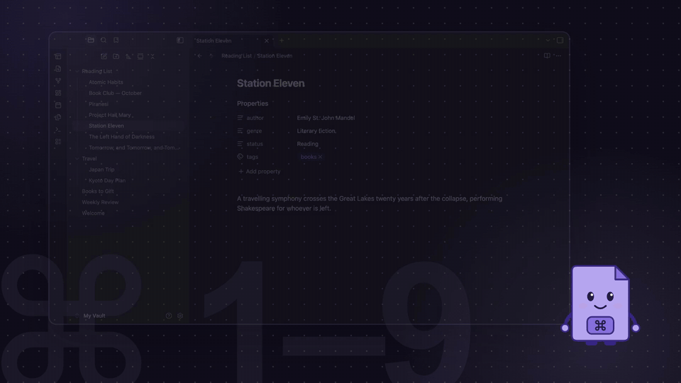
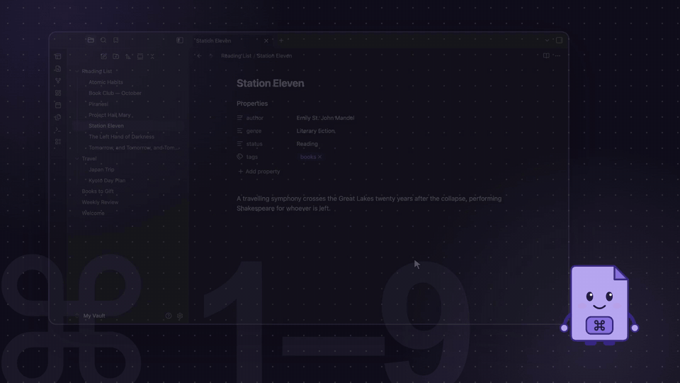
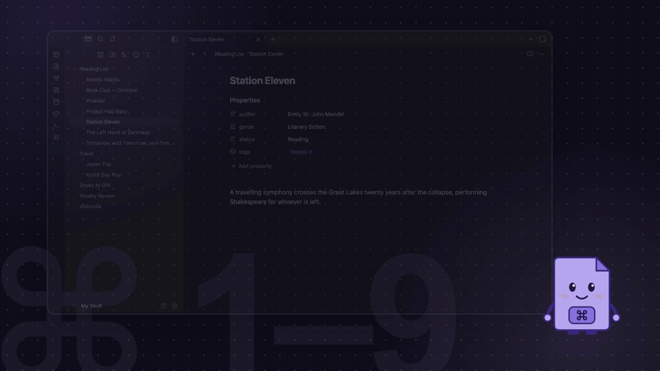
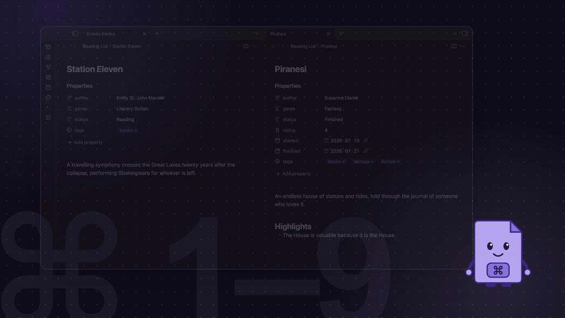
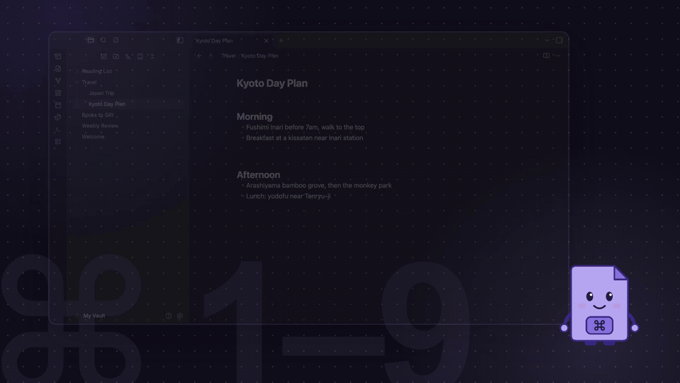
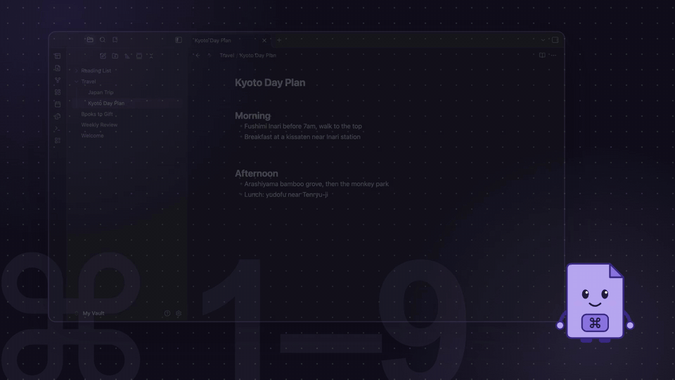

# Obsidian Quick Select

Pick any item in any Obsidian list with <kbd>Mod</kbd> + number. No arrow keys, no mouse.

[Watch in full quality (MP4)](docs/hero.mp4)

## How it works

1. Open any picker: the quick switcher, command palette, search, a tag or link suggestion, or a slash command.
2. Hold <kbd>Mod</kbd>. The first nine items are numbered.
3. Press <kbd>Mod</kbd> + a number to choose that item.

<kbd>Mod</kbd> is <kbd>Command</kbd> on macOS and <kbd>Ctrl</kbd> on Windows and Linux. You can change it in the settings.

## Works everywhere

Quick Select works in every Obsidian modal and suggestion list, including the ones that open from other modals.

### Quick switcher and command palette

### Tags (frontmatter and inline)

### Search options and history

### Workspaces

### Split panes

### Slash commands

## Settings

| Setting                      | Options                                     | Default |
| ---------------------------- | ------------------------------------------- | ------- |
| **Modifier key**             | Meta, Control, Alt                          | Meta    |
| **Counter transition style** | None, Fade, Slide, Permanent (always shown) | Slide   |

## Installation

### From Community Plugins

1. Open **Settings → Community plugins**.
2. Turn off **Restricted mode** if prompted.
3. Click **Browse** and search for "Quick Select".
4. Click **Install**, then **Enable**.

### Manual installation

1. Download `main.js`, `manifest.json` and `styles.css` from the [latest release](https://github.com/itsonlyjames/obsidian-quick-select/releases/latest).
2. Copy them into `<your vault>/.obsidian/plugins/quick-open/`.
3. Reload Obsidian and enable **Quick Select** under **Settings → Community plugins**.

## Compatibility

Works on desktop and mobile, including popout windows. Requires Obsidian 0.15.0 or later.

## Related plugins

- [Fold Properties](https://github.com/itsonlyjames/obsidian-fold-properties) folds the properties of a note, a folder or your whole vault in one click.
- [Sync Folds](https://github.com/itsonlyjames/obsidian-sync-folds) keeps your fold states in sync across devices.

## Support

If Quick Select speeds up your day, consider [sponsoring its development](https://github.com/sponsors/itsonlyjames).

## License

[MIT](LICENSE.txt)
